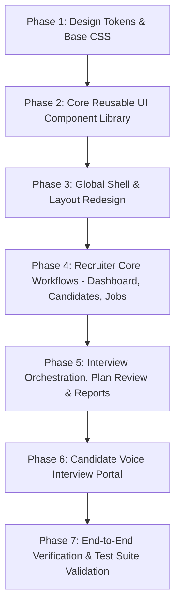

# AI Interviewer — Senior Frontend UI/UX Comprehensive Audit

**Author:** Senior Frontend Engineer & UI/UX Product Architect  
**Date:** 2026-11-04  
**Audit Scope:** Entire React 18 / Vite Frontend Codebase (`frontend/src/`)  
**Mode:** STRICTLY READ-ONLY AUDIT  
**Baseline Test Status:** 38/38 Unit & Component Tests Passing (`vitest run`)

---

## 1. Executive Summary & Design Vision

The AI Interviewer application is an end-to-end recruitment platform orchestrating candidate intake, AI-assisted interview plan synthesis, voice-driven candidate interviews, and evidence-backed evaluation reports. 

While the functional architecture, API integration, and security controls are robust, the current visual implementation suffers from the typical pitfalls of **first-generation AI demo interfaces**:
- A dark neon theme (`#0a0d14` background, cyan/purple glows, heavy drop shadows, and high-opacity glassmorphism cards).
- Heavy visual noise with oversized gradient buttons (`linear-gradient(135deg, #6366f1, #4f46e5)`), decorative backdrop filters, and saturated badges.
- Inconsistent spacing, arbitrary inline styling (`style={{ ... }}`), and missing design token discipline.
- Low data density in tables and cards, making it feel more like a consumer crypto dashboard than an institutional B2B enterprise recruitment tool (such as Ashby, Greenhouse, or Linear).

### The Target Design Direction
We recommend transforming the application into a **restrained, clean, light-mode enterprise SaaS workspace**:
- **Surfaces:** Crisp white (`#ffffff`) cards over soft neutral grey backgrounds (`#f8fafc` / `#f1f5f9`) with hairline borders (`#e2e8f0`).
- **Brand Accent:** Authoritative deep navy (`#0f172a` primary text, `#1e293b` active slate, `#2563eb` or `#1d4ed8` restrained corporate blue accents).
- **Typography:** Refined hierarchy utilizing Inter or Plus Jakarta Sans with strict sizing (11px micro-copy, 13px table cells, 14px body text, 20px page headers).
- **Decorations:** Zero glows, zero backdrop blurs, zero heavy gradients. Subtle micro-interactions and crisp 1px borders.
- **Enterprise Density:** High-density data grids, unified status badges with semantic tinting, consistent empty/loading skeletons, and accessible keyboard navigation.

---

## 2. Current Frontend Architecture

### 2.1 Technology Stack & Tooling
- **Core Library:** React 18.2.0 + React DOM 18.2.0
- **Build System:** Vite 5.1.0 with `@vitejs/plugin-react`
- **Routing:** `react-router-dom` v7.18.4
- **HTTP Client:** `axios` v1.20.0 (configured with JWT interceptors in `src/api/client.js`)
- **Iconography:** `lucide-react` v1.62.0
- **Testing:** `vitest` v1.6.0 + `@testing-library/react` (38 component tests active)
- **Styling Architecture:**
  - Global CSS tokens in `src/index.css` (254 lines).
  - Unused Vite boilerplate CSS in `src/App.css` (42 lines).
  - Extensive inline styles (`style={{ ... }}`) across all page components.

### 2.2 Global Styling & Token Analysis (`src/index.css`)
Currently, `index.css` defines dark mode tokens with heavy glassmorphism:
```css
/* Existing Dark Tokens */
--bg-primary: #0a0d14;
--bg-secondary: #111622;
--bg-card: rgba(19, 26, 42, 0.75);
--primary: #6366f1;
--shadow-glow: 0 0 25px rgba(99, 102, 241, 0.2);
```
**Issues Identified:**
1. **Glassmorphism everywhere:** The `.glass-panel` class enforces `backdrop-filter: blur(12px)` and translucent backgrounds, creating rendering overhead and legibility issues on non-GPU accelerated enterprise laptops.
2. **Hardcoded Inline Overrides:** Pages frequently bypass CSS variables with ad-hoc colors (`#334155`, `#1e293b`, `#a5b4fc`, `#10b981`), resulting in token drift.
3. **No Responsive Typography or Fluid Spacing Scale:** Spacing is manually specified as `24px`, `32px`, `14px`, `1.5rem` with no modular clamp or rem utility.

---

## 3. Existing Page and Route Inventory

| Route Path | Page Component | Access Control | Primary Function | Current Styling Issues |
| :--- | :--- | :--- | :--- | :--- |
| `/login` | `LoginPage.jsx` | Public | Recruiter/Admin JWT login | Dark cosmic radial gradient background, large glowing logo box. |
| `/register` | `RegisterPage.jsx` | Public | Recruiter invitation signup | High friction layout, manual token input step before showing form. |
| `/interview/session` | `CandidateInterviewPage.jsx` | Public (Token-protected) | Voice interview browser portal | Dark terminal aesthetic, oversized pulsing microphone ring. |
| `/admin/dashboard` | `AdminDashboardPage.jsx` | Admin-Only | Recruiter counts, invitation metrics | Massive metric cards, nested tables with inline widths. |
| `/admin/users` | `UserManagementPage.jsx` | Admin-Only | Recruiter directory & invite manager | Redundant tabs, basic HTML alert prompts for dangerous actions. |
| `/dashboard` | `DashboardPage.jsx` | Recruiter-Only | Recruiter pipeline overview | Generic KPI cards with neon icon squares, high dead space. |
| `/candidates` | `CandidatesPage.jsx` | Recruiter-Only | Candidate directory & CV extraction | Raw status text, no bulk actions or search/filter bar. |
| `/candidates/new` | `CandidateFormPage.jsx` | Recruiter-Only | Candidate creation & CV upload | Basic file input, missing drag-and-drop state, raw form fields. |
| `/jobs` | `JobsPage.jsx` | Recruiter-Only | Job requisition listing | Skills rendered as messy colored pills, no pagination controls. |
| `/jobs/new` | `JobFormPage.jsx` | Recruiter-Only | Job description & skills form | Unstyled textarea, comma-separated raw text input for skills. |
| `/interviews` | `InterviewsPage.jsx` | Recruiter-Only | Session scheduling & orchestration | Dense action buttons in table rows ("Review Plan", "Report", "Invite"). |
| `/interviews/new` | `InterviewFormPage.jsx` | Recruiter-Only | Schedule candidate to job requisition | Native unstyled `<select>` dropdowns, no candidate search. |
| `/interviews/:id/plan` | `InterviewPlanReviewPage.jsx`| Recruiter-Only | Structured AI question review | Long unformatted cards, lacks visual diffing or question reordering. |
| `/interviews/:id/report`| `InterviewEvaluationReportPage.jsx`| Recruiter-Only| AI grading rubric & decision | Long scrolling page, multiple nested accordions, neon score badges. |
| `/interviews/:id/session`| `MockInterviewSessionPage.jsx`| Recruiter-Only| Debug simulator for voice turns | Developer tooling exposed with production UI styling. |
| `/operations` | `OperationsPage.jsx` | Recruiter-Only | Background Celery task monitor | Developer debugging table, polling every 5s with raw JSON errors. |

---

## 4. Major UI/UX Problems Identified

### 4.1 "Generic AI" Aesthetic vs. Enterprise SaaS
- **Dark Neon Palette:** The `#0a0d14` background with `#6366f1` (indigo) and `#06b6d4` (cyan) gives the application the look of a Web3 crypto tracker or consumer gaming tool rather than a recruitment management system like Greenhouse, Lever, or Ashby.
- **Glassmorphism & Glows:** The use of `.glass-panel` with backdrop blurs, glow shadows (`--shadow-glow: 0 0 25px rgba(99, 102, 241, 0.2)`), and translucent cards reduces contrast and creates readability fatigue during long recruiting sessions.
- **Decorative Sparkles:** The `Sparkles` icon from `lucide-react` is used repeatedly in navigation, login, and badges, giving an AI novelty vibe rather than communicating enterprise utility.

### 4.2 Layout & Navigation Hierarchy
- **Fixed Width Desktop Sidebar:** `AppLayout.jsx` uses a fixed `width: '260px'` sidebar that does not collapse on smaller laptop screens or tablets.
- **Missing Breadcrumbs:** Deeply nested pages (e.g., `Interviews > Session 4 > Plan Review` or `Candidates > New`) rely solely on small "Back" buttons (`<ArrowLeft />`), lacking clear breadcrumb paths.
- **Header Underutilization:** The top navigation bar in `AppLayout.jsx` displays static text ("Console: Recruiter Access") without breadcrumbs, search, user avatar dropdown, or contextual page actions.

### 4.3 Data Tables & Information Density
- **No Search, Filtering, or Sorting:** Candidates, Jobs, and Interviews lists render all fetched items in basic HTML tables without search filters, tag filtering, or column sorting.
- **Action Clutter in Table Rows:** The Interviews table places up to 4 separate action buttons in a single row (`Generate Plan`, `Invite Candidate`, `Review Plan`, `View Report`), causing awkward text wrapping and misaligned table cells.
- **Lack of Pagination UI:** While the Django backend supports `PageNumberPagination` (page size: 20), the frontend does not render pagination controls or page counters.

### 4.4 Form Design & Feedback States
- **Raw Form Elements:** Inputs, selects, and textareas use basic styling with minimal focus ring affordances and no inline validation feedback.
- **Native Browser Confirmations:** Deleting, revoking invitations, and cancelling interviews trigger intrusive native browser popups (`window.confirm(...)`).
- **File Upload UX:** Resume upload is a standard unstyled `<input type="file">` without drag-and-drop target, upload progress bar, or parsed preview.

### 4.5 Candidate Voice Portal Disconnect
- The candidate-facing portal (`CandidateInterviewPage.jsx`) currently shares the dark tech aesthetic. A candidate undergoing an official job interview expects a calm, branded, corporate experience with clear step-by-step progress, explicit audio waveform indicators, and high-contrast transcription feedback.

---

## 5. Component Reuse & Consolidation Opportunities

Currently, component modularity is low. Almost every page reinvents cards, headers, alert banners, and modals from scratch with inline styles.

### Component Consolidation Matrix

| Existing Ad-Hoc Pattern | Current Locations | Recommended Consolidated Component |
| :--- | :--- | :--- |
| **Page Headers** | Duplicated across all 14 pages with `display: flex; justify-content: space-between` | `<PageHeader title="..." subtitle="..." actions={...} />` |
| **Stat / Metric Cards** | `DashboardPage.jsx`, `AdminDashboardPage.jsx` | `<MetricCard label="..." value="..." icon={...} trend={...} />` |
| **Status Badges** | `index.css` `.badge-*` mixed with inline colors across 8 files | `<Badge variant="success|warning|danger|neutral" status="..." />` |
| **Feedback Alerts** | Inline red/green divs with `AlertCircle` across 11 files | `<Alert type="error|success|info" title="..." message="..." />` |
| **Modal Windows** | `CandidateInviteModal.jsx` (490 lines of custom overlay) | `<Modal isOpen={...} onClose={...} title="...">` (Reusable dialog) |
| **Data Tables** | Duplicated `<table>` elements with manual `overflowX: auto` | `<DataTable columns={...} data={...} emptyMessage="..." />` |
| **Confirmation Dialogs** | `window.confirm()` in `UserManagementPage`, `MockInterviewSession` | `<ConfirmDialog isOpen={...} onConfirm={...} />` |
| **Empty States** | Text blocks with `color: var(--text-faint)` in tables | `<EmptyState icon={...} title="..." action={...} />` |

---

## 6. Responsive Design & Usability Issues

1. **Breakpoints Absent in CSS:**
   - There are virtually no `@media` queries in `index.css` (other than standard reduced-motion boilerplate in `App.css`).
   - On screens `< 1024px`, tables overflow awkwardly and form layouts wrap without structure.
2. **Mobile Sidebar Blocking:**
   - On viewports `< 768px`, the 260px fixed sidebar occupies more than a third of the screen with no hamburger toggle or off-canvas drawer.
3. **Modal Clipping on Small Laptops:**
   - `CandidateInviteModal.jsx` has a fixed height/padding that can overflow the viewport on 13" laptop screens (1366x768).

---

## 7. Functionality Preservation Requirements (Must NOT Break)

Any future UI redesign must strictly preserve the following battle-tested functional contracts:

1. **Role-Based Routing & Session State (`AuthContext.jsx`):**
   - JWT tokens stored in `localStorage` (`access_token`, `refresh_token`, `user_role`, `user_email`).
   - Admins redirect to `/admin/dashboard`; Recruiters redirect to `/dashboard`.
   - Axios interceptor auto-refreshes expired access tokens.
2. **Candidate Interview Invitation Workflow (`CandidateInviteModal.jsx`):**
   - Generation of 72-hour HMAC-SHA256 candidate URLs.
   - Nonce-authenticated resends without token regeneration (`/resend-candidate-link/`).
   - Token invalidation on fresh replacement (`/replace-candidate-link/`).
3. **Browser Audio Recording & Realtime Voice Pipeline (`CandidateInterviewPage.jsx`):**
   - `MediaRecorder` with `audio/webm;codecs=opus` container recording.
   - Multipart audio chunk submission to `/api/v1/candidate/submit-turn/`.
   - Streaming text-to-speech audio playback via `/api/v1/candidate/synthesize-speech/`.
   - Microphone permission management and consent recording.
4. **Celery Task Polling & Async Operations:**
   - Polling `/operations/<id>/` every 2–5 seconds until `succeeded` or `failed` for CV extraction and plan generation.
   - Terminal condition polling in `InterviewEvaluationReportPage.jsx` (`pending` / `processing`).
5. **Existing Vitest Component Test Coverage (38 Tests):**
   - Test queries rely on accessible role names (`screen.getByRole('button', { name: /.../i })`) and semantic inputs. Class/style changes must not break test queries.

---

## 8. Recommended Design System: "Enterprise Slate"

To achieve a clean enterprise recruitment SaaS look (similar to Linear or Ashby), we recommend adopting the **Enterprise Slate** token system:

### 8.1 Palette Tokens

```css
:root {
  /* Surfaces & Backgrounds */
  --surface-canvas: #f8fafc;       /* Slate 50: clean body canvas */
  --surface-card: #ffffff;         /* Pure white: distinct card elevation */
  --surface-sidebar: #0f172a;      /* Slate 900: high-contrast authoritative dark navy sidebar */
  --surface-hover: #f1f5f9;        /* Slate 100: interactive hover */
  --surface-muted: #e2e8f0;        /* Slate 200: subtle component backgrounds */

  /* Hairline Borders */
  --border-subtle: #e2e8f0;        /* Slate 200: crisp clean separation */
  --border-strong: #cbd5e1;        /* Slate 300: focused container borders */
  --border-focus: #2563eb;         /* Blue 600: accessible focus ring */

  /* Text & Typography */
  --text-primary: #0f172a;         /* Slate 900: sharp legible body */
  --text-secondary: #475569;       /* Slate 600: supportive labels */
  --text-muted: #64748b;           /* Slate 500: timestamps & micro-copy */
  --text-on-dark: #f8fafc;         /* White text on dark sidebar */

  /* Brand Accent */
  --brand-primary: #1e293b;        /* Slate 800: primary action fill */
  --brand-hover: #0f172a;          /* Slate 900: deep hover */
  --brand-accent: #2563eb;         /* Blue 600: links, interactive highlights */
  
  /* Semantic Status Indicators */
  --success-bg: #ecfdf5;           --success-text: #065f46;  --success-border: #a7f3d0;
  --warning-bg: #fffbeb;           --warning-text: #92400e;  --warning-border: #fde68a;
  --danger-bg: #fef2f2;            --danger-text: #991b1b;   --danger-border: #fecaca;
  --info-bg: #eff6ff;              --info-text: #1e40af;     --info-border: #bfdbfe;

  /* Elevation (No Glows) */
  --shadow-sm: 0 1px 2px 0 rgba(0, 0, 0, 0.05);
  --shadow-md: 0 4px 6px -1px rgba(0, 0, 0, 0.05), 0 2px 4px -1px rgba(0, 0, 0, 0.03);
  --shadow-lg: 0 10px 15px -3px rgba(0, 0, 0, 0.06), 0 4px 6px -2px rgba(0, 0, 0, 0.03);

  /* Geometry */
  --radius-sm: 4px;
  --radius-md: 6px;
  --radius-lg: 8px;
}
```

### 8.2 Typography Scale
- **Headings:**
  - Page Titles: `1.25rem` (20px), Semi-Bold (600), `letter-spacing: -0.015em`
  - Section Titles: `1rem` (16px), Semi-Bold (600)
- **Body:**
  - Standard Body: `0.875rem` (14px), Regular (400), `line-height: 1.5`
  - Table Cells & Form Inputs: `0.8125rem` (13px)
  - Badges, Table Headers, Metadata: `0.6875rem` (11px), Medium (500), uppercase tracking `0.05em`

---

## 9. Page-by-Page Redesign Recommendations

### 9.1 Global Layout (`AppLayout.jsx`)
- **Sidebar:** Transition to a crisp, high-contrast dark navy sidebar (`#0f172a`) with subtle 1px border. Navigation items should use subtle slate backgrounds on hover, with a clean 2px blue indicator on the active route.
- **Top Header:** Transform the static header into a functional workspace bar featuring breadcrumbs (e.g. `Candidates > Jane Doe > Plan`), quick search, and an interactive recruiter profile menu.
- **Responsive Drawer:** Introduce a responsive toggle for mobile/tablet screens that hides the sidebar into an off-canvas drawer.

### 9.2 Dashboard (`DashboardPage.jsx` & `AdminDashboardPage.jsx`)
- **Metric Cards:** Replace glowing gradient icons with clean, compact cards featuring a crisp 1px border, subtle numeric typography, and an icon badge with a soft neutral background.
- **Recent Activity Grids:** Structure recent interviews and recruiter invitations with clear status pills and secondary text (e.g. `Invited 2 hours ago by recruiter@example.com`).

### 9.3 Candidates Directory (`CandidatesPage.jsx` & `CandidateFormPage.jsx`)
- **Directory Search & Filters:** Introduce a top search bar with instant client-side filtering by candidate name, email, or consent status.
- **Resume Upload Box:** Replace the plain file input with an enterprise drag-and-drop zone with clear file format guidelines (`.pdf, .docx, max 10MB`), upload state animations, and a document preview chip.

### 9.4 Interview Management (`InterviewsPage.jsx` & `CandidateInviteModal.jsx`)
- **Consolidated Action Menus:** Replace multi-button clutter in table rows with a primary action button (e.g., "Review Plan" or "Generate Plan") plus a clean dropdown menu (`...`) for secondary actions (Invite, Revoke, Delete).
- **Invite Modal Overhaul:** Style `CandidateInviteModal` as a focused white dialog with clear tabbed states: `Email Invitation`, `Direct Link`, and `Delivery History`. Ensure one-click copy feedback with micro-animations.

### 9.5 AI Evaluation Report (`InterviewEvaluationReportPage.jsx`)
- **Executive Summary Header:** Present the candidate's aggregate score, recommendation status (`Strong Hire`, `Hire`, `No Hire`), and competency breakdown in a clean horizontal card.
- **Evidence Accordions:** Clean up the 4 competency evaluation blocks with distinct evidence quotes (indented with a 2px blue border), replacing dark cards with high-contrast white surfaces and soft grey quotes.
- **Recruiter Decision Form:** Anchor the hiring decision form at the bottom of the page with clear radio cards for `Hire`, `Hold`, or `Reject`.

### 9.6 Candidate Voice Portal (`CandidateInterviewPage.jsx`)
- **Atmosphere:** Adopt a light, distraction-free corporate environment (`#f8fafc` background) that puts candidates at ease.
- **Audio Feedback:** Replace the harsh red pulsing recording indicator with an elegant live audio waveform or subtle decibel level meter.
- **Live Transcription Card:** Render candidate and interviewer dialogue turns in clean chat bubbles with distinct timestamps and clear speaking indicators.

---

## 10. Recommended Implementation Phases

To eliminate risk and guarantee zero regression, the redesign should follow a staged, additive approach:



### Phase 1: Design Tokens & CSS Architecture
- Clean up `index.css`: Replace dark/glassmorphic tokens with the **Enterprise Slate** light-mode token system.
- Remove obsolete Vite boilerplate in `App.css`.
- Ensure dark mode tokens can still be toggled via data attribute if needed in future releases.

### Phase 2: Core Component Library Foundation
- Build zero-dependency, highly typed reusable components in `src/components/ui/`:
  - `Button` (Primary, Secondary, Outline, Danger, Ghost)
  - `Badge` (Status indicators with unified semantic tokens)
  - `Card` (White surface, 1px border, subtle elevation)
  - `DataTable` (Sortable, responsive, empty-state enabled)
  - `Modal` (Accessible dialog with backdrop click & escape listener)
  - `Input`, `Select`, `Textarea` (Form controls with error & focus rings)
  - `PageHeader` (Unified title, breadcrumbs, action slots)

### Phase 3: Shell & Global Layout
- Update `AppLayout.jsx` with the enterprise dark-navy sidebar and breadcrumb top bar.
- Redesign `LoginPage.jsx` and `RegisterPage.jsx` into clean, professional split-screen or centered enterprise login cards.

### Phase 4: Recruiter Pipeline Pages
- Refactor `DashboardPage.jsx`, `CandidatesPage.jsx`, `CandidateFormPage.jsx`, `JobsPage.jsx`, and `JobFormPage.jsx` to use the new UI components.

### Phase 5: Interview Orchestration & Reports
- Modernize `InterviewsPage.jsx`, `InterviewPlanReviewPage.jsx`, and `InterviewEvaluationReportPage.jsx`.
- Polish `CandidateInviteModal.jsx` and `InterviewTranscriptViewer.jsx`.

### Phase 6: Candidate Voice Portal Polish
- Modernize `CandidateInterviewPage.jsx` with light corporate styling, professional consent disclosure layout, and refined audio recording indicators.

### Phase 7: Verification & Test Protection
- Run full test suite (`npm run test`) to confirm all 38 tests remain green.
- Verify browser console produces zero accessibility or styling warnings.

---

## 11. Risks and Dependencies

1. **Test Selector Coupling:**
   - Some tests in `src/pages/__tests__/` query text inside buttons or badges (e.g. `getByRole('button', { name: /Add Candidate/i })`).
   - *Mitigation:* Preserve button text, role attributes, and form field labels verbatim.
2. **Inline Style Overrides:**
   - Existing components contain over 1,000 lines of inline styles that will override external CSS unless systematically replaced.
   - *Mitigation:* Refactor page by page, removing inline style objects in favor of token classes and UI components.
3. **No Added Dependencies Required:**
   - Everything required for this redesign can be achieved cleanly with native CSS variables and existing icons (`lucide-react`). No heavy CSS frameworks (e.g., Tailwind, Material UI, Chakra) are necessary, keeping bundle size small and build times instantaneous.

---

## 12. Recommendation for the Safest Redesign Approach

**Recommendation: The In-Place Incremental Component Refactor.**

Do not attempt a single-turn rewrite of all pages. The safest and most maintainable path forward is:
1. First establish the **Enterprise Slate** token system in `index.css`.
2. Extract the foundational atomic components (`Button`, `Card`, `Badge`, `PageHeader`, `DataTable`, `Modal`).
3. Migrate the application page-by-page in distinct phases, executing `npm run test` after each page migration to ensure continuous green test status.

This delivers an elite, professional SaaS interface while guaranteeing that token crypto, Celery async polling, JWT authentication, and browser WebM audio pipelines continue to operate flawlessly.

